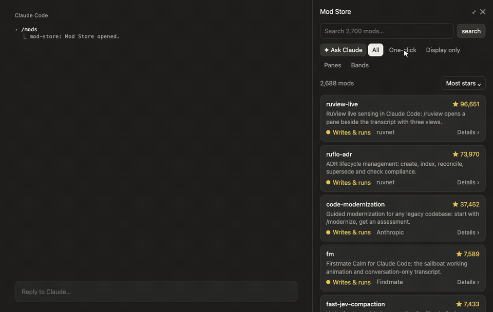

# Mod Store for Claude Code

**An app store for Claude Code mods, inside Claude Code.** Type `/mods`, search about 2,700 community mods, see what each one can access, and install it with one click. Or just ask Claude: *"find me a mod that shows my Spotify song"*.



## Install

```bash
claude plugin install mod-store --marketplace hellosverre/mod-store
```

Then run `/reload-plugins` and type `/mods`. Needs a Claude Code version with mods (tested on 2.1.292).

## What it does

- **Browse and search** every public mod in a side pane, sorted by stars, newest, or A to Z. Big repos with dozens of mods don't flood the top: the star sort shows each repo's best mod first.
- **Filter** to one-click installs, display-only mods, side panes, or bands above the prompt.
- **See the access before you install.** Every mod gets a badge, from green *Display only* to red *Network*, and its page lists what it can read, run and see, and where it shows up.
- **Install safely.** Install shows the exact command and the mod's permissions, and waits for you to confirm. Mods are installed with `claude plugin install`, never with `-y`, so a marketplace's own commands are never auto-accepted.
- **Ask Claude.** The mod gives Claude two tools, `search_mods` and `show_mod`. Describe what you want and Claude searches, compares a few, explains what each can access, and opens the best one. Claude can't install anything: you press Install yourself.

## Keys

| Key | Where | Does |
| --- | --- | --- |
| `i`, then `y` | a mod's page | Install, then confirm |
| `b` | a mod's page | Back to the list |
| Tab / arrows, Enter | anywhere | Move between items, open one |

## How it works

The catalogue comes from [mods.aidojo.si](https://mods.aidojo.si), which indexes public mods on GitHub, checks them with `claude plugin validate`, and works out what each one can reach. Mod Store downloads it in pieces (it's 7.5 MB), keeps a slimmed copy for six hours, and checks `claude plugin list` to mark what you already have.

Mod Store itself uses the network (to fetch the catalogue) and runs `claude plugin list` and `claude plugin install`. It reads nothing else on your machine.

## Develop

```bash
claude plugin validate .
claude plugin test .
```

## More mods

- [skins](https://github.com/hellosverre/claude-skins): tool rows with icons, diff and chart cards, fifteen themes
- [redgreen](https://github.com/hellosverre/redgreen): test results in a pane beside the chat
- [smart-compact](https://github.com/hellosverre/smart-compact): compacts after a commit, green tests, before the prompt cache expires, or when Claude asks

## License

MIT
